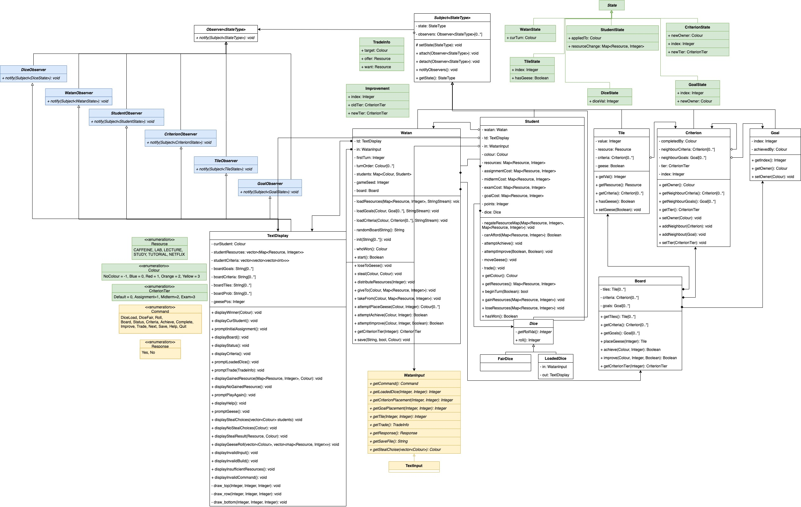

# Watan

Watan is a multiplayer, command-line strategy game inspired by *The Settlers of Catan*. It was built as a group project in object-oriented C++ with an MVC-inspired design.

The game supports four students (Blue, Red, Orange, and Yellow), a randomized or custom board, turn-based resource collection and trading, and saving and resuming games.



## Requirements

- A C++14-compatible compiler (the Makefile uses `g++`)
- GNU Make

## Build

From the project directory, run:

```sh
make
```

This builds the `build/watan` executable. To remove the generated build files:

```sh
make clean
```

## Start a game

```sh
./build/watan
```

Without options, Watan creates a randomized board using a time-based seed. To make the generated board reproducible, provide a seed:

```sh
./build/watan -seed 42
```

Load a saved game or a custom board file with `-load` or `-board`:

```sh
./build/watan -load save.txt
./build/watan -board board.txt
```

Both options read the supplied file and determine whether it contains a save or a board. A seed can also be supplied when loading:

```sh
./build/watan -load save.txt -seed 42
```

The seed controls newly randomized boards; loading a save or custom board uses the board encoded in that file.

### Custom board files

A board file contains one line of 38 integers: 19 pairs of `resource value`, one pair per tile. Resource IDs are:

| ID | Resource |
|---:|---|
| 0 | CAFFEINE |
| 1 | LAB |
| 2 | LECTURE |
| 3 | STUDY |
| 4 | TUTORIAL |
| 5 | NETFLIX |

Numbered tiles use roll values from 2 to 12. Use `0` for the value on a NETFLIX tile. For example, this is a valid board line:

```text
0 3 1 10 3 5 1 4 5 0 3 10 2 11 0 3 3 8 0 2 0 6 1 8 4 12 1 5 4 11 2 4 4 6 2 9 2 9
```

## How to play

The four students take turns in Blue, Red, Orange, Yellow order. At the start of a new game, each student gets two free Assignment placements: once in turn order and once in reverse order. Then regular turns begin.

On a regular turn:

1. Roll once with `roll`. By default, the dice are fair. Select `load` first to enter a roll manually, or `fair` to switch back to fair dice.
2. On rolls other than 7, students collect resources from matching tiles where they have criteria. A roll of 7 activates the geese: move them to a tile and, when possible, choose a student to steal from. Students holding 10 or more resources lose half their resources, rounded down.
3. Use resources to complete or improve criteria, achieve goals, or trade with another student.
4. Enter `next` after rolling to end the turn.

Criteria produce one resource per matching tile at the Assignment level, two at Midterm, and three at Exam. During regular play, a new criterion must connect to one of your goals and cannot be adjacent to another occupied criterion. Goals can be achieved next to one of your criteria or goals. Each successful criterion tier (Assignment, Midterm, and Exam) is worth one point; the first student to reach 10 points wins.

### Costs

| Action | Cost |
|---|---|
| Complete an Assignment | 1 CAFFEINE, 1 LAB, 1 LECTURE, 1 TUTORIAL |
| Improve an Assignment to a Midterm | 2 LECTURE, 3 STUDY |
| Improve a Midterm to an Exam | 3 CAFFEINE, 2 LAB, 2 LECTURE, 2 STUDY, 1 TUTORIAL |
| Achieve a goal | 1 STUDY, 1 TUTORIAL |

Trades are one resource for one resource between students; the target student must accept the offer.

## Commands

Commands are entered during a turn. Any requested index or trade details can be entered after the command on the same line or on subsequent input.

| Command | Description |
|---|---|
| `board` | Display the board |
| `status` | Show every student's resources and completed criteria |
| `criteria` | List the current student's criteria |
| `roll` | Roll the dice once for this turn |
| `load` | Use a manually entered dice result (2–12) on future rolls |
| `fair` | Use fair dice on future rolls |
| `complete <criterion>` | Complete an Assignment at a criterion index |
| `improve <criterion>` | Upgrade a criterion to its next tier |
| `achieve <goal>` | Achieve a goal by its index |
| `trade <colour> <give> <take>` | Offer one resource to a student for one of theirs |
| `next` | End the turn; only takes effect after rolling |
| `save <file>` | Save the current game state to a file |
| `help` | Display the in-game command list |
| `quit` | Exit the current game |

Colours are `Blue`, `Red`, `Orange`, and `Yellow`. Resource names are `CAFFEINE`, `LAB`, `LECTURE`, `STUDY`, and `TUTORIAL`.

For example:

```text
roll
complete 12
trade Red CAFFEINE STUDY
next
```

To resume a saved game, pass its filename to `-load` when starting Watan.

## Project structure

```text
.
├── assets/
│   └── UML.jpg             # Class diagram
├── include/                # C++ headers
├── src/                    # C++ implementations and main.cc
├── Makefile
├── README.md
└── build/                  # Generated executable, objects, and dependencies
```

Headers and implementations use matching names. The build directory is generated by `make` and ignored by Git.
